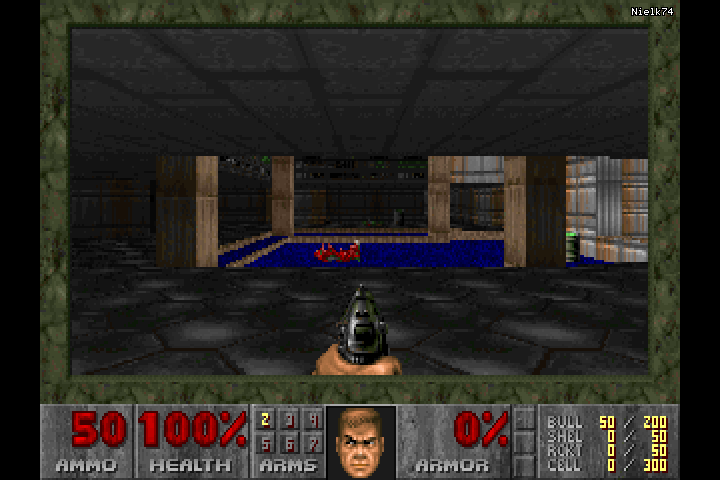

# DOOM on the Ricoh GR III

A small experimental native DOOM port for the **Ricoh GR III, firmware 2.10**.
Launch it from the shooting screen with Fn, play with the camera buttons, and
press MENU to return to the camera. A tiny fixed `Nielk74` watermark sits in
the upper-right corner of the game.



The owner reported the initial build running on a GR III on November 1, 2026.
The ADJ controls and watermark in this revision have automated ARM checks;
this revision still needs testing on the camera. The image above is an emulator
capture, not a photograph of the camera display.

## Start and exit

1. Build the candidate below from your own official GR III **2.10** firmware.
   The verified output is named **`fwdc239b.bin`**, the name expected by the camera.
2. Once that firmware is installed, open the camera's Customize Controls menu
   and assign **Aspect Ratio** to the **Fn button**.
3. Return to the ordinary still-photo shooting screen and briefly press **Fn**.
4. Press the **ADJ lever inward** to open the DOOM menu and confirm selections.
   The OK button is optional.
5. Press **MENU** to close the game and enter the camera's normal menu.
   Pressing Fn from the shooting screen resumes the session.

DOOM and the watermark draw only on the active game's live-view canvas. Camera
menus do not receive the game overlay. This build starts from official 2.10;
it does not combine other camera mods.

| Button | Action |
| --- | --- |
| Fn on the shooting screen | Start or resume |
| Direction buttons | Move forward/backward and turn |
| ADJ lever pressed inward | Confirm selections / fire |
| OK | Optional confirm / fire backup |
| Fn during gameplay | Use / open doors |
| DISP | Automap |
| MENU | Exit to the camera menu |
| Shutter, playback, supported mode transitions | Exit and continue native processing |

## Build and run the complete checks

Requires Python 3.12 and Node.js **24.5.0 or later**. The compiler is installed
through the pinned `ziglang` Python package. No npm dependencies are needed.
Keep downloads and generated binaries in ignored `scratch/`.

```powershell
python -m venv .venv
& .venv/Scripts/python.exe -m pip install -r requirements.txt
New-Item -ItemType Directory -Force scratch/deps
Invoke-WebRequest https://raw.githubusercontent.com/Daivuk/PureDOOM/355cfbd16fac119718879239336ee2ea408886bd/PureDOOM.h -OutFile scratch/deps/PureDOOM.h
Invoke-WebRequest https://raw.githubusercontent.com/Daivuk/PureDOOM/355cfbd16fac119718879239336ee2ea408886bd/doom1.wad -OutFile scratch/deps/doom1.wad
& .venv/Scripts/python.exe tools/check.py --engine scratch/deps/PureDOOM.h --wad scratch/deps/doom1.wad --firmware C:/path/to/official/fwdc239b.bin --out scratch/checked
```

Use a **new output directory** on every run. `check.py` runs the entire suite:
150 synthetic codec cases with four allocation hints each, host relocation/WAD
contracts, real ARM menu navigation and firing through ADJ, exact watermark
pixels, gameplay and movement, two relocated runtime bases, both framebuffer
strides, memory guards, packaged camera hooks, canvas ownership, MENU exit,
timer cancellation, resume, allocation failure, destruction, and native updater
and BOOT loader probes for both banks.

On success, the local outputs are:

- `scratch/checked/firmware/fwdc239b.bin`: verified candidate with the camera filename.
- `scratch/checked/check.json`: candidate SHA-256 and full-suite result.
- `scratch/checked/firmware/`: container, camera and loader verification reports.
- `scratch/checked/runtime/`: runtime manifest, ARM executables and frame captures.

The tools do not detect a card, install firmware, or flash a camera. Sound, music,
saves and configuration writes are disabled. The game reads its embedded IWAD
from memory. Physical timing, concurrent camera tasks, LCD/cache behavior and
memory pressure remain outside the emulator checks.

For the fast public codec tests alone, run `npm test`. For the host Python
contracts alone, run `python -m unittest discover -s tools -p test_build.py -v`.
These are subsets; `tools/check.py` is the complete verification command.

## Source layout

- `tools/gr3_doom.c`: bounded memory and IWAD adapter, buttons, 640×480 rendering,
  and the 41×7-pixel watermark with a one-pixel outline.
- `tools/camera.c`: native live-view, input, timer, private stack and exit hooks.
- `tools/build.py`, `pack.mjs`, `inspect.mjs`: ARM build, exact instruction guards,
  container checksums and independent decoding.
- `tools/verify*.py`, `test_*.py`, `check.py`: host and actual ARM checks.
- `vendor/grmod/`: the small container/probe subset needed from
  [Ricoh-GRMod](https://github.com/Maxwooow/Ricoh-GRMod).

The runtime uses an 8 MiB arena and a private 128 KiB stack; the full session
allocation is roughly 9.6 MB. The builder links at two addresses and accepts
only complete internal pointer fixups. Embedded assets are hash checked, and
the packer accepts only the exact official firmware listed below. The firmware
version/header and all non-RTOS sections are retained.

## Inputs and attribution

| Local input | SHA-256 |
| --- | --- |
| Official GR III 2.10 `fwdc239b.bin` | `d6a3c9c288d784080e7b283222ecdd8752adfeed6faa36dab44f73115354bfd4` |
| Pinned `PureDOOM.h` | `ec16ce721436bf3fa4c338320afedd56a93c0b563a94ebf283718503c71ca780` |
| Tested shareware `doom1.wad` | `1d7d43be501e67d927e415e0b8f3e29c3bf33075e859721816f652a526cac771` |

Port source and extracted Ricoh-GRMod code are GPL-2.0-only; see [LICENSE](LICENSE)
and [NOTICE.md](NOTICE.md). [PureDOOM](https://github.com/Daivuk/PureDOOM) at commit
`355cfbd16fac119718879239336ee2ea408886bd` is obtained separately under the original
DOOM Source Code License. Its header, the IWAD, Ricoh firmware and generated
combined binaries are not included or relicensed by this repository.
